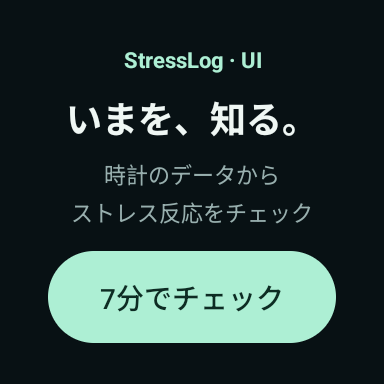
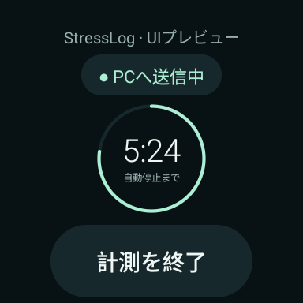
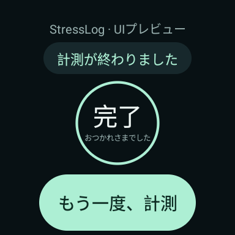

# 時計UIの刷新 — v0.5.5 UIプレビュー

ブランチ: `ui/watch-refresh`。通常の計測アプリを置き換えず、新しい画面を確認する段階です。

## 画面

以下は384×384 px・320 dpiの丸型設定を使ったAndroidエミュレーターでの画面です。
実際のPixel Watchで撮影した画像ではありません。計測中の画面はプレビュー用の例示表示です。

| ホーム | 計測中の表示例 | 終了後 |
|---|---|---|
|  |  |  |

## 変更した内容

- 普段使うホームを新設。診断用の項目を最初に並べない構成。
- 黒に近い背景、ミントの主要ボタン、丸いカード、短い説明へ統一。
- ホームの「7分でチェック」から7分モードを直接開始。既に計測中なら「計測をひらく」に変わり、計測時間をリセットしない。
- 計測画面は状態、残り時間のリング、開始・終了操作を優先。
- 連続モードは「計測モードを選ぶ」から選択可能。
- PC送信確認待ちと装着待ちは黄色系、送信確認中はミントで区別。色だけに頼らず文字も表示。
- 件数・例外名などは「接続の詳細」にまとめ、通常画面の説明を短くした。
- スクロールとリューズの回転操作を受け付ける。文字サイズ拡大時もスクロールして操作できる構成。
- 常時アニメーションは追加していない。状態更新は画面表示中だけ5秒間隔。

## 変更していない内容

`LiveMeasurementService.kt`、センサー取得周波数、HTTPS通信、送信間隔、PCの推定処理、
ストレス計算、7分終了や非装着時の処理は変更していません。
新しいストレス通知機能も追加していません。

通常版ソースはv0.5.5ですが、v0.5.4の未解決の計測サービスを継承しています。
以前の時計フリーズを直したという主張はしません。通常版を実機へ自動的に配備しません。
確認済み計測用APK v0.5.2もそのまま保持します。

## UIプレビューの性質

| 項目 | 内容 |
|---|---|
| アプリID | `com.nishi.stresslog.watchprobe.preview` |
| 名前 | StressLog UIプレビュー |
| バージョン | 0.5.5-ui-preview / code 12 |
| センサー・インターネット等の権限 | プレビュービルドで削除 |
| 計測サービス・診断画面・接続設定画面 | プレビュービルドで無効 |
| 「開始」「終了」 | 画面表示だけ切り替える。実測もPC送信もしない |
| 表示例の残り時間 | 固定の例示。実際に7分後に停止する試験ではない |
| 確認済みの計測アプリ | 別IDなので上書きしない |

画面にはUIプレビューの表示を入れています。プレビューを装着データの受信確認に使わないでください。
プレビューAPKは `releases/watch/stresslog-watch-ui-preview.apk`。
SHA-256と確認結果は `releases/watch/ui-preview.json`。

## 時計で画面だけ確認する

開発者向けオプションでワイヤレスデバッグを有効にし、現在の接続用IP:ポートを確認します。
すでにペアリングしたPCで、リポジトリ直下から:

```powershell
powershell -ExecutionPolicy Bypass -File .\scripts\Install-WatchUiPreview.ps1 -DeviceAddress 192.168.1.20:42001
```

値は時計の現在の表示に置き換えます。ペアリングがまだなら `docs/SETUP.md` のADBペアリングを先に行います。
通常の計測アプリを削除・更新したり、PC受信用のトークンを変更したりしません。

## ソースから再ビルド

JDK 17、Android SDK platform 35 / build-tools 35.0.0を用意し、環境変数を設定します。

```powershell
.\gradlew.bat -Pandroid.overridePathCheck=true :watch-probe:assembleUiPreview :watch-probe:lintUiPreview
```

出力: `watch-probe/build/outputs/apk/uiPreview/watch-probe-uiPreview.apk`。
プレビューはこのソースから再ビルドできます。同梱v0.5.2 APKの元ソースが回収できたという意味ではありません。

主なソースは `HomeActivity.kt`、`LiveActivity.kt`、`WatchUi.kt`、`res/values/styles.xml`。
プレビューの機能制限は `build.gradle.kts` と `src/uiPreview/AndroidManifest.xml`。
通常版の実機配備と計測の確認は、未解決の計測サービスの扱いを整理してから別途行います。
